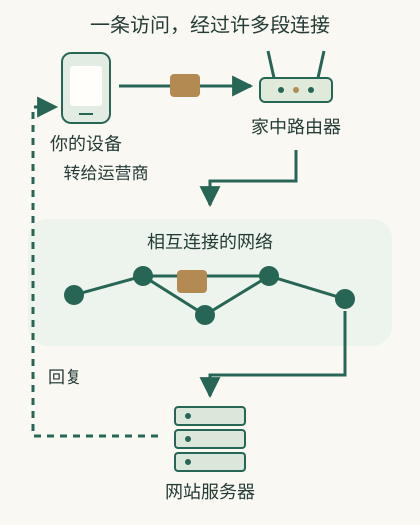

# 从一次上网出发，建立完整的网络地图

朋友发来商品链接，你点开、看图片、登录，再把商品加入购物车。一个熟悉的动作背后，至少有三方在合作：**浏览器准备请求，网络把请求与回复送来送去，网站查找内容并处理操作。** 页面和账号不会只靠一条“网线接通”就自动完成全部工作。

你不需要先背参数。沿着同一次访问，看清谁收到什么、接着做什么，再把IP、端口、域名、VPN放回它们参与的位置。

## 先跟着一段日常经历走

下面使用一个**虚构购物网站**，名称、商品和结果均为教学设计，不对应任何平台的内部实现。链接是 `https://shop.example.com/products/42?color=blue#reviews`。

### 一、浏览器先读懂链接中的访问要求

你点链接，浏览器读出网站名称shop.example.com，知道要请求42号商品、附带蓝色选择，并在适当时候定位到评价区。链接表达“准备去哪里、想看什么”，此时页面还没取到。

HTTPS表示采用受保护的网页通信方式；名称、路径、问号和井号后的内容各有用途。详细拆分见[一条网址](24-url.md)。

### 二、设备要先接入网络，才能联系远处

电脑通过家里的Wi-Fi联系接入设备，再由路由器和宽带接入连接运营商。运营商网络与其他网络相连，才让请求有机会继续到网站所在的网络。

Wi-Fi满格，只说明附近无线信号这一项条件；外部线路中断时，家中电脑和打印机仍可能通信，远处网页却取不到。见[连网与上网](02-access.md)。

### 三、名称查成地址，再找到接收程序

浏览器通常通过DNS这种名称查询系统，取得网站的IP地址。设备按目的地址转送数据，再用端口联系接收网页请求的程序。普通HTTPS没有写端口时，会采用默认443，不是没有端口。

IP帮助到达网络目标，端口帮助交给接收程序，网页请求还要保留主机名和具体路径。一个IP可以有多个网站，一个网站也可以有多个地址；并不是每件商品都另配一个端口。见[IP](04-ip.md)、[端口](25-ports.md)、[名称查询](06-dns.md)。

### 四、小份数据逐段传送，网站才收到需求

请求被组织成可以传送的数据，经不同设备接力。每一段连接可以使用电、光或无线电信号；沿途设备依据网络信息继续送，不需要理解你想买哪种颜色。

两端还要按需要处理丢失、顺序和传输保护，才有条件交换完整请求。家中多台设备可以共用公共出口，出口记录通信对应关系，把回复送回正确设备。见[信号](01-signals.md)、[分包](03-packets.md)、[路由](07-routes.md)、[交付](08-delivery.md)与[共享出口](05-nat.md)。

### 五、网站找内容，浏览器把它显示出来

商品程序收到请求，才读取42号商品和蓝色条件，查找相应资料，返回页面说明。浏览器继续取得图片、排版规则和页面程序，逐步显示标题、图片和按钮。它不是收到远处电脑的一整张截图。

图片可能来自另一个子域名，库存可能需要另外查询；因此文字正常、图片失败、某个按钮等待，都可能发生在同一页面。见[网页怎样组成](09-web.md)与[多级域名](26-domains.md)。完整连续轨迹在[从点击到页面](28-browsing.md)。

### 六、登录和下单，还要网站处理新的请求

登录时，网站验证凭据，给浏览器保存适用的登录标记。后面查看订单，浏览器附上标记，网站找到账号，再核对有权查看什么。

点提交则让网站核对资料和业务条件，创建相应记录，再返回结果。回复中断时，记录也可能已经保存；所以超时以后需要核对正式状态，不能只凭动画判断。见[网站怎样认得账号](14-identity.md)与[提交何时成功](29-transactions.md)。

这张图表示常见访问中的接力关系，并不包含所有设备与应用安排。不同服务可以采用不同的连接和部署方式。

## 把六个问题放回自己的位置

| 日常问题 | 这次访问里对应的工作 | 为什么要分开看 |
|---|---|---|
| 设备接上了吗？ | 附近接入与上游连接 | 接上Wi-Fi不保证外部网站回应 |
| 信息往哪里送？ | 名称查询、地址与路由 | 找到地址还要继续联系目标 |
| 到达后谁接收？ | 端口、连接与服务程序 | 同设备上可以运行不同服务 |
| 想看或提交什么？ | 网页请求中的主机、路径、参数等 | 同一网站可以处理许多内容 |
| 有权吗，办成了吗？ | 账号、权限与业务记录 | 通信成功不等于业务获准 |
| 屏幕显示什么？ | 浏览器解释内容、运行页面程序 | 已显示的内容不证明新操作完成 |

网络设备本身也运行软件。这里是帮助辨别职责，不是把现实设备分成互不相关的学科。关系见[网络、网页和软件](30-boundaries.md)。

## 换网络、连VPN，为什么会改变一部分结果

出门后，你从家中Wi-Fi切到手机流量，接入和公共来源可能改变，浏览器保存的登录标记却仍在。因此，购物账号还可以保持，不需要网站根据新IP重新猜人。

公司报销页则可能只允许内部访问。公司VPN先在现有网络上联系另一端，再转送指定内部通信，普通购物仍走原出口。于是报销页恢复、公网IP查询没变，也可能符合目的。另一种VPN用途才是把公共访问经指定出口发出。见[VPN](16-vpn.md)、[分流](17-split.md)和[配置验证](18-setup.md)。

IP因此既能帮助转送，也能成为平台观察来源、累计请求和比较地区的线索。多人可能共用来源，同一个人也会换来源；重要线索并不等于精确的个人身份证。见[IP与风控](15-risk.md)。

## 按眼前的问题继续读

想先理解日常链接，可以沿[网址](24-url.md) → [IP](04-ip.md) → [端口](25-ports.md) → [子域名](26-domains.md) → [路径参数](27-url-pages.md) → [完整访问](28-browsing.md)阅读。

想解释通信体验，可以从[聊天送达](10-messages.md)、[视频会议](11-live.md)、[网速](12-speed.md)或[谁能看见内容](13-security.md)进入。正在配置或遇到故障，则看[VPN设置](18-setup.md)、[访问排障](19-troubleshoot.md)、[远程访问](20-remote.md)与[分享网页](21-deploy.md)。

目录始终可以自由选择，不要求按顺序完成。读到陌生名称时，[名词索引](22-glossary.md)提供简短解释与对应正文，过程中的关键联系则会留在各篇文章里。
