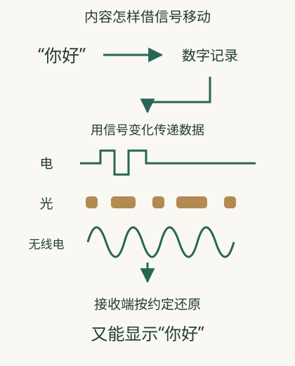

# 文字和声音，怎么进入电线与空气？

你在手机里说一句“到了吗”，朋友几秒后从耳机里听见。你的声音没有以原来的声波穿过城市。**手机先把声音记成数据，网络把数据送过去，朋友的手机再把数据变成新的声音。** 文字和照片也要先有一种设备能保存、处理和传送的表示方式。

## 按住录音按钮后，手机先保存了什么

以发送语音消息这个日常动作为例。你对麦克风说话，声音使空气振动，麦克风把这种变化变成设备能够处理的信号。设备反复记录声音在不同时刻的变化，把它们记成数字，再按音频格式组织起来。

这里的数字记录是可以保存的内容。松开录音按钮后，即使房间已经安静，手机仍能根据记录播放刚才那句话。语音文件也不需要一直“发着声音”才能存在：它可以躺在手机存储里，过几天再打开。

把内容按约定记成数据，叫作编码。文字也有编码规则，例如把“到”这个字与相应的数字记录对应起来。接收软件要知道使用了什么规则，才能把数字重新显示成那个字。图片则记录画面信息，音频记录声音信息；文件格式帮助软件知道该怎样解释这些数据。

所以，成功收到一串数字还不是最后一步。如果软件不支持某种音频格式，它可能拿到完整文件却无法播放。这与网络没有传完整，是两种问题。

## 点发送以后，数据怎样离开手机

聊天软件把准备好的语音数据交给手机的通信功能。手机若使用家中Wi-Fi，就按无线通信规则让天线发出可识别的无线电变化，附近的接入设备据此恢复数据。你走到离路由器很远的位置时，这段无线通信可能变差，发送就可能变慢或失败。

接入设备收到后，再按下一段连接的方式发送。下一段可能用网线中的电信号，也可能在后面的光纤中用光信号。一段接一段，接收、恢复、继续发送，最终把数据交到聊天服务和朋友的设备。

不是同一道无线电波一路飞到朋友家，也不是把声音原样塞进光纤。**内容以数据形式继续传递，每一段连接可以使用不同的物理信号。** 正因为能够这样衔接，手机、光纤网络和有线电脑才可以相互通信。[Wi-Fi使用无线电传送信息](https://www.cisco.com/site/us/en/learn/topics/networking/what-is-a-wi-fi-network.html)

实际通信不会简单到“每亮一次就代表一个数字”。系统用双方能够区分的变化组合表示数据，也需要处理干扰和错误。你不用先掌握这些参数，先抓住“发送端制造变化，接收端按同样规则识别”即可。

## 朋友手机收到以后，为什么能播放出你的话

朋友的手机从网络取得音频数据，聊天软件按相应格式读取它，恢复可播放的声音信号，再交给耳机或扬声器。扬声器制造新的空气振动，朋友才听见那句话。

这条过程可以分为三个阶段：你的手机记录声音，通信系统搬运记录，朋友的手机根据记录播放。语音可以离线保存、重复播放，也可以在不同设备上播放，就是因为中间传递的是能够复制的数据记录。

若数据尚未取得完整，应用可能等待、提示下载失败或采用自己的恢复办法；若记录已经完整，耳机没有声音，还可能是播放设备、音量或格式的问题。仅凭“听不见”不能确定在哪一段失败。

## 照片发出去变糊，是不是网络磨掉了细节

下面是一个**虚构教学对照**。你拍了一张清楚的照片，在聊天软件里按默认方式发送。软件先制作体积更小的图片版本，再上传。朋友成功下载了这个版本，放大却觉得模糊。

减少需要保存或传送的数据量，叫作压缩。有些压缩可以完整恢复原记录；有些会舍弃图片或声音的一部分细节，用更少数据换更小体积。本例中，细节在发送前就已经被舍弃了，网络完整送到的也是这个较小版本。

因此，重新发送同一个压缩版本，通常不会凭空找回原图细节。若应用允许选择“原图”或发送原文件，发出的内容变了，体积与等待时间也可能增加。你看到的是应用选择和处理文件的结果，不能把画质变化都归为信号好坏。

若原文件已经完整下载却仍打不开，则还应检查文件本身和软件支持情况。照片模糊、文件未收全、软件不支持格式，分别发生在不同步骤。

## 编码、压缩和加密，为什么要分清

同一段语音可以先编码成数据，再压缩，发送时再受到加密保护。这些处理可以同时存在，各自解决不同问题：

| 处理 | 用这段语音来理解 | 不等于什么 |
|---|---|---|
| 编码 | 按约定记录声音，使软件能保存和解释 | 不代表别人一定无权读取 |
| 压缩 | 减少文件需要的数据量 | 不代表内容受到保密保护 |
| 加密 | 用密钥等安排，使未获准者难以读懂内容 | 不代表文件一定更小 |

打开文件看到一串看不懂的字符，可能只是用了不合适的软件解释，并不能据此证明文件已加密。反过来，一张很小的图片也可能完全没有受到保密保护。加密保护哪一段、谁仍能读取，见[信息能被谁看见](13-security.md)。

声音怎样变成可传的数据解决了“传什么”。接下来还要知道如何分享连接、送往谁、缺了一段怎么办。见[分包](03-packets.md)、[IP地址](04-ip.md)与[丢失后的恢复](08-delivery.md)。
