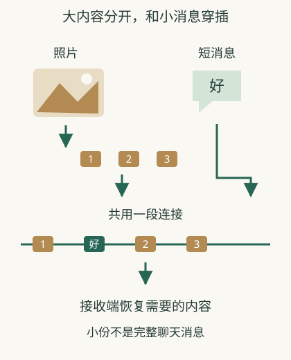

# 一张照片为什么要分成许多小份？

你上传一组照片时，旁边的人还能发消息、刷网页。网络需要让这些通信共享连接，而不是一张照片从头到尾占住所有传送机会。**数据会被组织成许多较小的传送单位，各次访问可以穿插使用连接。** 这些传送单位通常叫数据包。

## 一边上传照片，一边发一句“稍等”

以下是一段**虚构教学过程**。你在聊天软件里选了几张照片，按下发送。软件先决定上传哪些文件，再把文件数据交给设备的通信功能。设备不会要求沿途每台机器先空出一整张照片的容量，而是分批把数据送出去。

假设为方便示意，把正在传的照片数据写成甲、乙、丙三段。刚送完甲，你又发一句“稍等”。设备有机会在继续传照片段之前，先传文字消息或其他应用的数据。沿途共用连接的设备也会安排接下来传哪一份。

这里的三段只是教学标记，真实照片通常远不止三份；它也不是照片左边、中间、右边各装一包。照片文件有自己的记录格式，一份数据可能只是格式中的一小段，不能直接当作画面上的一块。

## 每一份上面，为什么还要带地址

沿途设备收到一份数据，需要知道下一步往哪里转送，所以数据包不只装照片内容，还带有目的IP等交付信息。网络把数据送到聊天服务器以后，接收设备也要分清它属于哪个程序、哪次通信。

聊天软件另在自己的请求中写明收件账号。于是有三件相接的工作：目的地址帮助到达聊天服务，端口与连接信息帮助把数据交给接收程序，聊天服务再根据账号决定给哪位朋友。

这也是为什么“发给同一个朋友”不意味着每份数据上都写着朋友手机的当前位置。常见聊天安排是先交给服务，再由服务联系朋友。[IP负责寻址](https://www.rfc-editor.org/rfc/rfc791.html)；[端口](25-ports.md)与[聊天账号](10-messages.md)继续完成后面的分工。

## 甲、丙先到了，乙没到，接收端会怎样

如果使用需要完整、有序交付的传输方式，接收端会记录已经取得的数据，并反馈接收情况。发送端依据反馈和等待情况补发缺失部分；接收端把补齐的数据按正确顺序交给应用。

应用最终获得的是可以按文件格式读取的数据，而不必把网络里的实际到达顺序原样展示出来。所以你可能只看见上传进度暂时停住，稍后继续，而不会在成品照片上看见“路上丢掉一包，所以永久缺了右上角”。[TCP的有序交付](https://www.rfc-editor.org/rfc/rfc9293.html)

这也不是说所有图片都必须完全收齐后才出现：某些格式或应用可以边取得边显示。关键在于显示方式由格式与程序决定，不能从“分包”直接推断成品一定变成马赛克。

## 可以穿插，为什么大上传仍会拖慢会议

把大内容分小，并没有增加连接本身的容量。假设家中上行连接已经持续忙着发送照片，会议声音、网页请求和一些接收确认也要等待传送机会；若某处等待队列越来越长，用户就会感觉操作变慢，队列装不下时还可能丢弃数据。

因此，“可以共享”不等于“各自有一条保证畅通的独立线路”。短消息很小，也可能遇到排队；不同设备如何调度、应用是否先处理照片、上游哪里拥堵，都会影响实际结果。

若暂停照片备份后会议明显改善，可以把同时上传造成的压力列为检查方向；仅凭一次改善，仍不能确定所有等待都发生在家中路由器。速度与排队见[网速为什么不只看带宽](12-speed.md)。

## 断网再恢复，是否必定从刚才的百分比继续

要分清两个尺度。一次通信中缺了少量数据，传输机制可能补发；连接已经失败以后，照片应用是否还保存任务、是否允许从某个位置续传，是另一项产品能力。

有的应用可以恢复已有上传，有的会重新发送整个文件，也有的需要用户重试。进度条恢复不能证明底层一直保持同一连接，进度条归零也不能说明此前从未有数据到达。

同样，数据包可以经过同一路径，网络变化后也可能改走其他路径。“分成很多份”只说明怎样组织传送，不意味着每一份都故意分走一条不同道路。路径如何选择见[逐跳转送](07-routes.md)，缺失怎样补回见[信息交付](08-delivery.md)。
