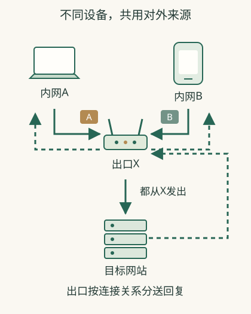

# 电脑的IP与网站看到的IP，为什么不一样？

电脑网络设置里是一个地址，IP查询网页却显示另一个地址，这常常是正常现象。**在常见的共享IPv4上网方式中，家中设备使用内部地址，对外访问经过共同出口；出口转换地址，并保存通信的对应关系。** 网站因此可能看到相同的来源，回复却仍能回到正确设备。

这种转换与记录的机制叫NAT。它解释一种常见网络安排，不代表所有IPv6或所有VPN连接都采用同样方式。

## 家里两个人同时逛商品站，网站回复谁

以下是**虚构教学过程**：电脑A和手机B连接同一家中网络，都在浏览同一购物站，但各自登录自己的账号。

电脑A先发出商品请求。家中出口收到后，记下“A的这条内部连接，对应哪一条向外通信”，再把来源转换成对外使用的地址。手机B随后发出请求，出口为B也保留一份对应关系。为了区分通信，记录不只看IP，也利用端口等信息。

网站现在看到两次请求使用共同的公网来源，但两条通信仍可区分。网站沿相应连接发回回复。出口接到以后，查自己的记录，把A的回复转给A，把B的回复转给B。**共用一个对外IP，并不等于所有回复混进同一个无法区分的袋子。** [共享地址与连接区分](https://www.rfc-editor.org/rfc/rfc6269.html)

家中路由器不是读完订单才决定“这是爸爸的、这是妈妈的”。它依据通信记录转送；购物网站则根据各浏览器携带的登录标记，查出不同账号的购物车和订单。地址转换与账号识别在同一次访问中各做各的工作。

## IP查询页为什么不能列出家中所有设备

查询页能报告的是它收到的访问来源。本例中，它看到的是共同出口，就报告出口的公网地址。它不需要、也不能仅凭这次访问直接枚举家中A和B的全部内部地址。

因此，你在电脑和手机上打开同一个查询页，可能看到相同IPv4；两台设备的网络设置里却各有不同的内网IP。两种观察分别在说“内部怎样联系”和“外面看到从哪里来”。

共享还可能发生在更上游。运营商可以让多个家庭共用公共出口，公司、校园和VPN服务也可能汇集许多人的访问。看到同IP，只能先把它理解为同一网络来源，不能直接下“同一个人在操作”的结论。

## 我能收到网站回复，为什么朋友不能主动连进来

继续用电脑A的访问看：A主动发请求时，出口已经建立对应记录。网站的回复沿这条通信回来，出口知道应该转给A。

现在改一个条件：朋友从外面第一次联系你家的某个服务。对于这条新通信，出口可能既没有现成记录，也没有规则说明该交给家中哪台设备，而且防火墙可能不允许接收。它不会因为你曾经能上网，就把陌生请求随意转给某一台电脑。[主动出站与外部发起连接](https://docs.aws.amazon.com/vpc/latest/userguide/vpc-nat-gateway.html)

所以，“我可以下载文件”与“外面的人可以访问我的文件服务”需要不同条件。前者接收既有访问的回复，后者要为新访问提供合适的入口和许可。

## 端口转发，是怎样把新访问交给家中设备

假设你明确需要对外提供一项自有服务，并按设备和网络提供者的要求安排入口。端口转发规则可以表达：“发到我公共入口这个端口的新通信，转给家中指定设备的指定端口。”公网与内网两侧的端口编号可以不同。

它只补上这段转送关系。家中程序还要运行、接受相应网络的请求，设备防火墙要允许，服务账号也要有权限。改一个数字不会自动创建程序或取得权限。

如果运营商前面又做了一次地址共享，朋友的请求可能根本没有机会到达你家路由器。只改家中转发规则，不能替运营商建立上游入口。自有设备的远程访问可以采用[获准的私有连接](20-remote.md)；公共网页也可以交由[托管服务](21-deploy.md)提供入口。这些是不同方案，不需要为了理解原理就修改真实网络。

## 静态、动态、共享，为什么不能混着说

“静态”或“固定”描述按安排地址是否保持；“动态”描述地址可能随接入安排变化。动态不表示每刷新一次就变，固定也不表示只给一个人用。

例如，把家中电脑内部IP固定，是让其他家中设备更容易一直找到它。运营商提供的对外地址仍可能变化。反过来，公司可以长期使用一个固定出口，却让很多员工共同上网。

| 说法 | 它回答的问题 | 不自动意味着什么 |
|---|---|---|
| 固定内网IP | 在这个内部网络里，怎样稳定找到设备 | 获得固定公网IP |
| 固定公网出口 | 网站看到的来源是否按安排保持 | 只有一个用户使用 |
| 共享出口 | 多人的访问是否汇在同一来源 | 地址一定经常变化 |
| 独享出口 | 该服务承诺的地址使用范围是否只分给某个客户 | 平台一定信任，或服务一定对外开放 |

购买服务时，“固定”和“独享”应分别问清楚。它们也不能代替[风控](15-risk.md)对来源历史、账号和行为的判断。

## 换热点后IP变了，购物车为什么没清空

从家庭出口换到手机热点，新的通信可能使用另一公共来源。浏览器里保存的登录标记却仍在；购物站读取这个标记，可以继续查到同一个账号的购物车。购物车存在网站的账号记录里，不是存放在公网IP这串数字中。

已有的某条网络连接可能在切换时中断，应用再建立新连接，重新请求资料。因此，你可能看见短暂转圈后恢复，不能把“账号还在”误解为“底层那条连接从未变化”。[账号与会话](14-identity.md)继续解释网站怎样把前后操作关联起来。

## IPv6为什么可能不需要共用这个IPv4出口

使用IPv6时，设备可以各自拥有公网地址，不必为了解决IPv4地址共享而统一改成同一个来源。查询页看到设备自己的公网IPv6，也可能是正常结果。

但地址可以在公网使用，仍不等于允许任何人主动访问。程序是否接收、路由是否可达、防火墙是否放行、账号是否获准，依然需要分别满足。共享地址和访问保护有关联，却不能把“没有NAT”理解为“没有任何保护”。
