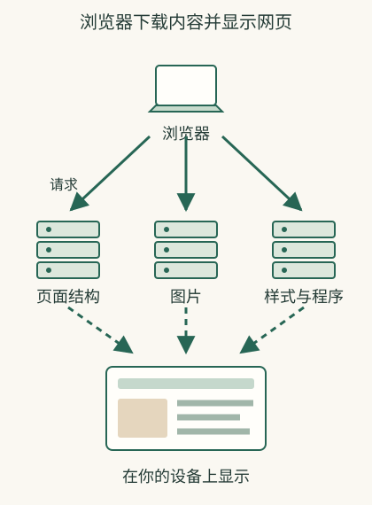

# 打开一个网页，背后是谁在回答？

商品页先出现标题，过一会儿才出现图片；点“查看运费”，页面又转了一次圈。**浏览器通常分几次取得页面所需的内容，再在你的设备上组合显示。按钮也可以在页面打开后继续向网站请求新结果。** 你看到的一张网页，背后可能有许多次通信。

## 浏览器和网站服务器，分别在哪里工作

浏览器运行在你的电脑或手机上，负责接收输入、发送请求、解释页面内容和显示结果。网站服务器是提供服务的计算机及其运行程序，负责接收请求、找出内容、核对资料并回复。

它们通过HTTP这样的规则交换需求与结果。浏览器发出的说明叫请求，服务器针对它发回的内容叫响应。响应可以是商品页面，也可以只是一张图片、一份库存数据，或一条拒绝说明。[网页请求与响应](https://developer.mozilla.org/en-US/docs/Web/HTTP/Guides/Overview)

“服务器”不一定只是一台机器。你接触的是统一网址，后面可以由多台设备、多个程序共同提供服务；一个接收入口也可以先把请求交给另一个程序处理。

## 打开42号商品页，第一份内容是什么

以一个**虚构商品站**为例。浏览器联系网站后，请求42号商品页面。网站返回的可以先是一份HTML文档：它说明哪里是商品标题，哪里是价格，哪里需要图片，哪里有按钮。HTML可以先理解为页面的结构与内容说明。

文档还可能告诉浏览器：“去这个地址取商品图片，去那个地址取排版规则，再下载负责按钮功能的程序。”浏览器读取这些说明，继续请求所需文件。CSS常用来描述外观和排版，JavaScript常用来处理点击、更新页面和继续取数据。

文件可以并行下载，也可以陆续发现、陆续取得。因此，标题先到就先显示，图片晚到才补上，按钮相关程序尚未完成时还可能暂时不能用。网页不是从远处电脑传来的一整张可点击截图。

你不需要学写这三种代码。先区分：页面需要显示什么，怎样摆放，以及用户点击后怎样响应。这些由浏览器取得的内容和本地程序共同决定。

## 点击“查看运费”，页面为什么不用重新打开

假设你选择配送城市，点“查看运费”。页面程序读取城市和商品信息，向运费服务发一个新请求。运费服务按配送规则计算，把结果发回来；页面程序收到以后，把原先“待查询”的位置替换成金额。

此时地址栏可以完全不变，因为并没有要求浏览器重新进入一整张新页面。相反，点评价区可以只在本地滚动，不需要发新请求。两个动作都表现为“点了按钮”，但一个需要服务回答，一个只操作已有内容。

如果本地展开说明正常，运费一直转圈，说明浏览器仍能执行某些界面动作，却没有取得这项查询所需的结果。不能由“按钮还能点”推断网络与服务都正常，也不能由“一个按钮失败”推断整张页面从未下载成功。

## 图片、库存与下单，可能由谁提供

这个虚构站可以把页面放在shop.example.com，图片放在img.example.com，把库存查询放在api.example.com。浏览器显示一张页面时，就可能同时联系几个名称。

管理员也可以只用一个主机名，再按不同路径分给商品、库存和订单程序。名称怎样划分是部署选择，不是每项功能必须另买一个域名。

所以，页面正常而图片失败，可能与图片那次下载有关；图片正常而下单被拒，可能是订单规则给出结果。观察时说清具体缺哪部分，比“网站坏了”更有用。[子域名](26-domains.md)和[路径参数](27-url-pages.md)解释这些入口怎样表达。

## 第二次打开很快，是不是内容没经过网络

浏览器可以把取得的图片、程序等保留副本，规则允许时重复使用。这叫缓存。再次访问时，有的资源可以直接使用本地副本，有的需要先问服务有没有更新，有的必须重新取得。[缓存如何复用与核对响应](https://www.rfc-editor.org/rfc/rfc9111.html)

网站还可以借CDN在不同地点安排接收和分发服务器。某个节点保存着可用副本时，可以就近提供图片等内容；需要实时处理的请求，也可能由它继续交给网站后台。CDN不是把所有业务都变成永远有效的旧文件。

因此，第二次变快可能是少下载了一些内容、少建立了一些连接，不必是宽带突然变快。刷新也不保证各层副本全部丢弃，更不能保证购物站的旧价格仍适用于最终订单。

## 断网以后页面还在，为什么库存又查不到

假设页面已经下载并显示，此时网络中断。屏幕上现有的标题、图片不必立即消失，你还可能滚动、展开本地说明。可“查看最新库存”需要再次向服务器请求，结果就可能取不到。

页面可见，只说明已有内容仍能显示。库存、登录和提交需要各自完成相应通信与处理。完整浏览顺序见[从点击到看到页面](28-browsing.md)，点击提交后怎样区分显示反馈与真实记录，见[操作何时成功](29-transactions.md)。
