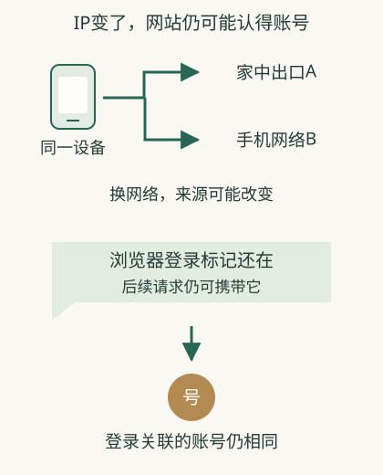

# 换了IP，网站为什么还认得你？

你从家中Wi-Fi换成手机流量，购物站仍显示原来的头像和订单。**网站可以通过浏览器携带的登录标记，找到同一个账号；它不必根据新IP重新猜测你是谁。** 网络来源、浏览器会话与账号，是几种能够同时存在的识别线索。

## 从第一次进入，到“我的订单”出现

以下是**虚构购物系统**。你第一次打开首页，网站可以给这段访问一个编号，记录语言偏好或未登录购物车。随后你输入账号和密码，网站核对通过，再把有效登录状态与账号关联。

网站让浏览器保存一份相应标记。常见做法是放进Cookie：这是浏览器按范围规则保存，并在适用请求中发送的数据。标记可以只是一个难以随意伪造的关联编号，不必直接写着你的姓名；账号资料和会话记录可以保存在服务端。[Cookie怎样支持登录状态](https://developer.mozilla.org/en-US/docs/Web/HTTP/Guides/Cookies)

你点“我的订单”时，浏览器又发出请求，并按规则附上标记。网站核对它是否有效、过期或已撤销，找到对应账号，再检查这个账号有权看哪些订单，最后返回结果。

所以连续点击不同页面，不需要每次重新输入密码。网站也不是因为看见同一IP，就把别人家的订单交给你。真正授权访问，需要验证相应凭据和权限。

## 从Wi-Fi切到流量，哪一项变了，哪一项还在

手机切换网络后，新请求的来源IP可能变化，原有某条连接也可能中断并重新建立。但浏览器存储没有因为切网自动清空，登录标记仍可以随后续请求发出。

网站再次收到有效标记，就仍能找到原账号的订单和购物车。保存的订单在网站那边，浏览器只需要证明这次访问有权读取，不必让公网IP始终保持不变。

服务也可能把来源和设备变化列为额外检查线索，要求重新验证。这是会话与风控的设计，不是所有网站都必须“IP一变立即退出”，也不是登录标记永远不会失效。

## 同一办公室共用IP，账号为什么仍能分开

同事甲和乙各自在自己的浏览器登录，浏览器保存不同会话标记。两人的请求经过共同出口，网站看到相同来源IP，却仍可验证两份凭据并返回各自资料。

反过来，一个人使用手机和电脑登录同一账号，可以对应两个会话、两种来源，却仍读取同一账号记录。于是“来自哪里”“哪段访问”“登录哪个账号”不是一一对应。[共享IP造成的识别歧义](https://www.rfc-editor.org/rfc/rfc6269.html)

账号也不必等于一个自然人：可能有组织授权共用账号，一个人也可能拥有多个账号。网站记录某账号执行过操作，与证明某个自然人亲手执行，仍是不同程度的判断。

## 换浏览器或清Cookie以后，为什么又要求登录

另一个浏览器通常没有自动复制原浏览器的登录标记。网站接到的请求缺少有效凭据，就可能先显示登录页。清除网站Cookie也可能产生类似效果：本机不再携带原标记，但服务器上的账号、订单和其他会话不会因此自动删除。

你重新登录同一账号，网站核对通过后仍可以显示先前订单。没有凭据可用，与账号资料不存在，是两件事。

退出登录则应由网站处理会话失效或撤销，使相应凭据不能继续授权。退出是否同时影响其他设备、多久生效，要看产品说明；不能只看地址栏切到首页就确认所有设备已经退出。

## 主站已经登录，帮助站为什么还要再登

Cookie有发送范围。某份标记可能只发给shop.example.com，另一份可能按适当父域名范围发送；路径、保护要求及浏览器规则也会影响实际发送。

即使同属一个品牌，help.example.com的登录服务也未必使用相同会话。网站可以专门建设共享登录，让两边配合；不能只凭域名长得相近，就推断凭据自动通用。

页面程序能否读取另一个来源的数据，还涉及同源等规则。这与Cookie能否发送、业务账号是否共用有关联，却不是同一套判断。具体区别见[子域名与登录](26-domains.md)。

## 设备指纹怎样帮助关联，又为什么不能当身份证

网站可能取得浏览器类型、语言、设备环境等特征，把组合用于比较访问是否可能相关。这类做法常称设备指纹。它是关联判断，不是一个永远不变、全球唯一的硬件编号。[风险产品公开的设备与会话输入](https://support.maxmind.com/knowledge-base/articles/device-inputs-minfraud)

同类设备可能相似，系统升级或设置变化又会改变特征。因此，看到“环境相似”不能直接证明同一自然人；看到“环境不同”也不能直接证明账号被盗。

| 动作 | 首先改变的东西 | 不会自动做到的事 |
|---|---|---|
| 换Wi-Fi、流量或VPN出口 | 某些连接的来源与路径 | 删除账号和历史订单 |
| 清除网站Cookie | 本浏览器保存的相应标记 | 清除服务端全部记录 |
| 退出登录 | 相应会话的授权状态 | 隐藏一切来源与行为线索 |
| 换设备后重新登录 | 本地环境、会话和可能的网络来源 | 让网站无法关联同一账号 |

网站认人时，可以同时查看来源IP、有效凭据、账号、设备环境和行为。不同线索各有作用，也各有误差。它们怎样参与验证码和异常登录判断，见[IP与风控](15-risk.md)。
