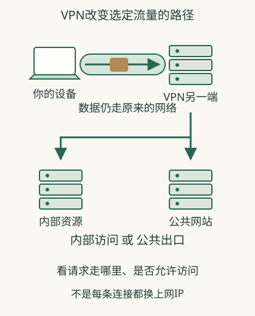

# VPN究竟改变了哪一段通信？

你在家可以购物，却打不开公司报销系统；连接公司VPN以后，报销页能打开，公共IP查询结果却没变。**VPN先借现有网络联系另一端，再把指定通信经这条连接送过去。它可以只接通内部系统，也可以让公共上网经另一处出口。** 要看用途和覆盖范围，不能只看“已连接”。

## 在家打开公司报销页，多了哪一步

以下是**虚构公司场景**。内部报销系统只接受公司安排的网络访问。你在家直接打开时，可能连名称都查不到，也可能知道地址却没有可达路径。

你打开公司指定VPN客户端，按要求验证身份。客户端先通过家里的网络联系公司VPN服务器，双方建立受保护连接。接下来，客户端按照公司规则，把发往内部系统的通信交给这条连接；必要时，内部名称查询也采用公司的安排。

公司VPN服务器收到以后，把里面发往报销系统的通信继续送过去。报销系统返回页面，数据再通过公司VPN回到家中设备，浏览器才显示内容。系统仍可能要求报销账号登录，连接资格与业务权限各自核对。

普通购物访问如果不在公司分流范围，仍经家庭出口。因此“报销页能打开”和“查公网IP没变”可以同时成立；这恰好可能符合公司只转送内部访问的目的。[内部成员连接与公共出口的区别](https://tailscale.com/docs/features/exit-nodes)

## 所谓隧道，是不是另拉了一条物理网线

没有。可以把通信分成里面和外面两层来理解：里面的数据说明“去报销系统”；客户端把它装进受保护的VPN通信，外面这层先说明“去公司VPN服务器”。家中路由器和运营商按外层目标继续转送。

到达公司VPN服务器后，服务器去掉外面这层处理，按里面的目标继续发送。报销系统的回复则沿相应连接返回。把一层通信装在另一层里传送，常称隧道。

这条隧道仍要靠原来的Wi-Fi、网线或移动网络运行。本地接入彻底断了，客户端连VPN服务器都联系不到，就不能靠“VPN已安装”继续送数据。VPN不是一份可以脱离现有网络独立运行的互联网。

## 想让网站看到另一处来源，过程怎样不同

换一个**虚构公共出口场景**：你希望指定访问从远方出口发出。客户端将适用的网站通信先送入VPN隧道；另一端再联系公共网站，网站通常观察到出口的公网来源。回复先回到出口，再经VPN送回你的设备。

这次改变的是公共访问的后半段路径与网站看到的网络来源。验证时，应在目标应用中确认实际来源是否符合所选出口；只证明内部报销能用，并不能证明这项目的也完成。

工具也可能要求另行选择或批准出口。普通私有成员网络可以先只连接获准设备，不默认接管公共上网。两种能力可能在同一个客户端里，开了其中一项，不代表另一项自动开启。

## “已连接”后，为什么仍可能打不开目标

连接成功，首先说明设备与VPN另一端已建立相应通信。下一步还有几个独立条件：内部名称是否查对，目标流量是否在覆盖范围，另一端是否能联系目标，目标程序是否运行，以及账号有没有使用权限。

例如，你到达报销登录页，却收到无权查看某部门资料，这通常已经超过“隧道有没有建立”的问题；若客户端自身提示认证失败，报销网站可能还没有参与。

按阶段区分，才知道应核对连接资料、路径范围还是业务账号。[配置与验证](18-setup.md)给出对应操作，[分流](17-split.md)解释为什么不同软件可能结果不同。

## 切换节点，为什么有时更快、有时更慢

节点通常指提供连接或转送的另一端。换节点，会改变先到哪处网络、后半段怎样联系网站，也可能改变来源地区、共用活动与服务观察到的属性。

如果新路径更适合目标服务，体验可能改善；若绕行更长、出口拥堵或本地到节点不稳定，体验也可能变差。VPN服务器还要处理通信，因此不能从“开启VPN”直接推断统一加速。

网络来源变了，浏览器保存的登录标记未必变化，网站仍可以认得账号。平台是否要求验证，还要看自己的规则，不是节点名字自动决定。

## VPN和HTTPS分别保护哪里

VPN通常保护隧道两端之间的通信。HTTPS可以同时保护浏览器与实际HTTPS接收端之间的网页内容；两种保护覆盖的参与者和范围不同。VPN出口参与向目标转送，但普通转送HTTPS数据不等于可以解密正文。[传输保护的范围](https://developer.mozilla.org/en-US/docs/Web/Security/Defenses/Transport_Layer_Security)

VPN提供者仍可能取得相应连接线索，网站也仍处理你提交的账号和资料。因此，VPN不能自动删除登录记录、保证完全匿名或补足网站权限。理解时分别问：先到哪里、哪些通信经过、哪一段受到保护。远程访问自有设备的具体场景，见[远程连接](20-remote.md)。
