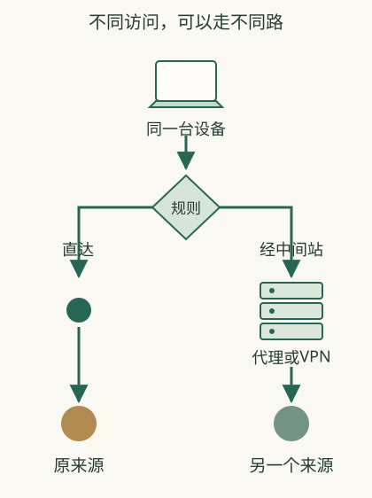

# 全局、分流、代理，为什么影响的应用不同？

浏览器开了代理后能正常访问，会议软件却还是卡；公司VPN连上以后报销页能开，IP查询页又没变。**连接工具需要先决定接管哪些通信，其他通信仍可能使用原来的路径。** “开启”描述工具状态，不直接说明整台设备的所有请求都经过它。

## 浏览器代理先接走了哪一项工作

以下是**虚构对照**：你按提供者资料，在某浏览器中设了代理。原先浏览器直接联系商品站，现在适用请求先交给代理，再由代理联系目标，结果经代理返回浏览器。代理可以理解为替某些请求出面联系目标的中间服务。

会议软件是另一个程序。它可能既不读取这个浏览器的设置，也不支持同样的通信方式，仍按自己的安排发送声音。所以浏览器改善、会议未变，可以是覆盖范围不同，而不是同一个开关“有时有效、有时无效”。

某些代理会替你查询目标名称，另一些安排仍由本地查询。看到“代理”二字，还不能断定DNS和所有数据都经过同一位置。

## 系统代理与VPN，为什么不是同一个入口

系统代理把一份代理配置提供给应用，愿意并能够采用它的应用按相应规则工作。某些软件有独立设置，或使用不适用这项代理的通信，因此不一定跟随。

网络层VPN可以通过系统路由等安排，把选中的通信装入隧道。应用不必都设置一个浏览器代理地址，但哪些目标、地址类型或应用被覆盖，仍受系统、客户端和规则限制。

还有一些客户端把代理和VPN式接管放在同一界面中。产品名字叫VPN，不表示它每个模式都采用同样接管方式；按钮名字相同，也不能推出不同产品范围相同。[Mac VPN的配置选项](https://support.apple.com/guide/mac-help/set-up-a-vpn-connection-on-mac-mchlp2963/mac)

## 分流怎样让公司系统与购物站分开走

设想公司给出的规则是：内部报销和文件服务走公司VPN，普通互联网访问仍走家庭出口。设备按目标匹配规则，报销请求进入隧道，购物请求直接交给家中网关。这种按条件选择路径的安排，就是分流。

规则可以根据地址范围、域名、应用等条件设计，实际由工具能力和提供者配置决定。它不是让用户每点一次都亲自选路，而是把相应选择交给已有规则。

报销系统恢复、公共查询仍显示家庭来源，就可能是这份规则的预期结果。要验证公司系统，观察具体内部任务；要验证公共出口，才看相应公共访问的来源。[出口节点承载的流量](https://tailscale.com/docs/features/exit-nodes)

## 全局模式为什么还可能有例外

“全局”常表示在某个工具负责的范围内，尽量统一采用指定路径。范围可能是全部适用代理请求，也可能是公共网络流量，并不保证所有本地、系统和协议活动都完全相同。

例如，某个公共出口方案可以接管互联网访问，同时允许你继续联系家中打印机；也可以默认不允许本地访问，再提供单独选项。公司方案还可能保留管理规则。你要核对产品说明，而不是把全局翻译成“一切活动隐形”。

设备同时使用IPv4和IPv6时，工具也需要有相应覆盖安排。若某类通信未接管，它可能采用原路径；一次查询显示新来源，不能代表所有可能路径。

## 同时开两个工具，请求可能怎样绕

假设浏览器先把商品访问交给代理P，而设备的VPN又把去P的底层通信送进VPN。这时一次访问可能是：设备先通过VPN抵达P，再由P联系商品站。目标看到的来源与只开其中一个工具时未必相同。

也可能代理设置让公司内部请求走错入口，或另一工具接管了内部名称查询，使报销页不再可用。两个都显示已连接，只能说明各自建立了一部分状态，不能证明组合路径符合目的。

如果启用第二项以后问题才出现，可以先恢复本次新增设置，再比较同一目标是否恢复。一次只改变一项，才容易解释差异；公司受管规则按管理员流程处理，不随意删除。

## 查IP网页能验证什么，不能验证什么

查询页报告的是它接到的那次访问来源。如果浏览器使用代理，而下载软件直连，查询页和下载服务可以看到不同来源。若页面分别检测IPv4和IPv6，两项结果也可能不同。

因此，把验证放回真实任务：报销页能不能打开，文件能不能读取，会议能不能传声，目标浏览器是否使用预期公共出口。工具状态和一次查询只是其中部分证据。

| 常见选项 | 具体要问的问题 |
|---|---|
| 节点、出口 | 先联系哪里，再由哪里联系目标？ |
| 分流规则 | 哪些请求走这里，哪些仍走原路径？ |
| 允许本地网络 | 开启后，家中打印机等目标还能否联系？ |
| 断线保护 | 隧道断开后，是恢复直连，还是继续阻止相关通信？ |

断线保护会使“VPN断开以后仍不能上网”成为可能的预期行为，而不一定是原宽带又坏了。连接前记录原设置与恢复方法，按提供者说明验证和撤销本次改动，见[VPN配置](18-setup.md)。
